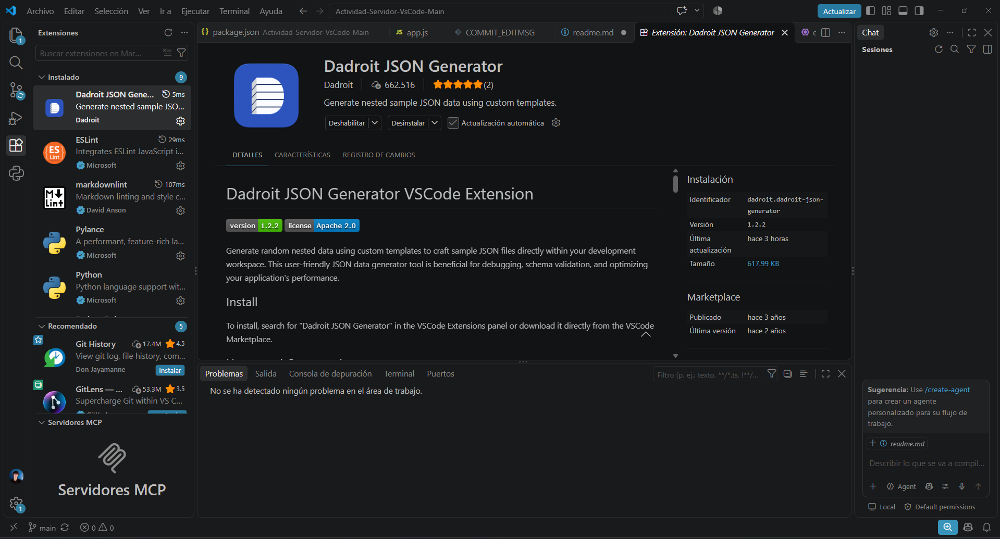
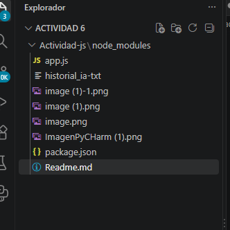
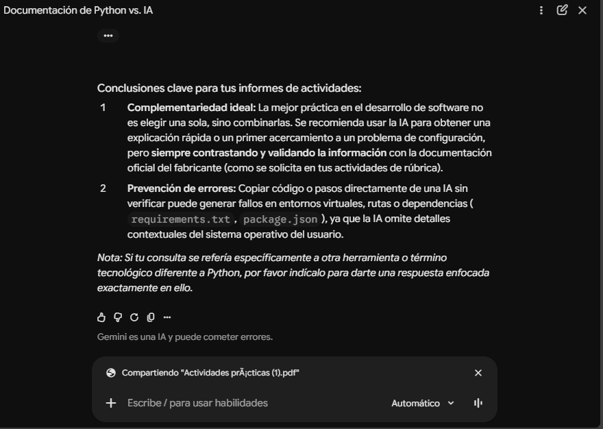

 imagen 1:
 esta imagen muestra una de las extensiones que tuve que utilizar para conectar con el servidor.
 
 imagen2:
 -1.png>)
 en esta imagen podemos ver que tuvimos que instalar node.js ya que tambien la necesitabamos por que una de estas extensiones se necesitaba para hacer lo del servidor.
 tenemos tambien la estructura del proyecto:
 
 aqui podemos mostrar la organizacion de nuestro proyecto se muestran los archivos principales.

 
 aqui en esta imagen nos muestra la aplicacion de pycharm ya con lo que es el desarollo avanzado lo que ya nos permite ya ejecutar el codigo como tal.

 -1.png>)
esta imagen muestra que el programa se esta iniciando y ya se entrelaza con los demas entonces basicamente para que esto funcione toca descargar algunas extensiones para que esto funcione.
comparacion entre cada documentacion:
documentacion oficial de pycharm: esta documentacion esta completa muestra como tal todos los pasos que tenemos que seguir para asi mismo descargar la aplicacion.
documentacion que me dio la IA:esta documentacion que me dio la IA fue muy basica fue soalmente como lo mas basico y no realamente una profundizacion.
problemas encontrados: estos fueron los problemas encontrados al ejecutar el problema.

-1.png>)
el siguiente problema que se encontro fue tambien el siguiente este error sale por que el servidor no esta activado.

.png>)

las soluciones para este problema fueron las siguientes:
_ activar el servidor 
_ ejecutar los codigos de manera correcta para que esto si funcionara.
_ se muestra los pasos para realizar la actividad.
.png>)

 # evidencia de inteligencia artificial texto:

Parece que en tu consulta hay un pequeño error de tipeo y te refieres a la documentación oficial de Python o al contraste entre la documentación oficial y la ayuda asistida por IA (co mo ChatGPT), un tema central en varias de las actividades prácticas de tus guías de estudio (por ejemplo, en la Actividad 5 de la Unidad 1).

A continuación, te presento una comparación detallada entre el uso de la documentación oficial y el uso de asistentes de IA para aprender a configurar entornos y programar, ideal para que lo utilices en tus informes académicos:

Tabla Comparativa: Documentación Oficial vs. Asistencia con IA
Criterio	Documentación Oficial (ej. Python.org, VS Code Docs)	Asistencia con IA (ej. ChatGPT, Copilot)
Precisión y Confiabilidad	Alta y verídica. Es la fuente directa de los creadores del software; raramente contiene errores técnicos sobre las herramientas.	Variable. Puede cometer errores ("alucinaciones") o dar información desactualizada si la versión del software cambió recientemente.
Claridad y Nivel de Detalle	Suele ser muy técnica, formal y extensa. A veces resulta densa o difícil de comprender para principiantes.	Muy accesible. Explica los conceptos de forma simplificada, adaptándose al nivel que le pidas (ej. "explícamelo como si fuera un principiante").
Ejemplos Prácticos	Ofrece ejemplos estándar y casos de uso estructurados bajo buenas prácticas de desarrollo.	Genera ejemplos personalizados y rápidos adaptados exactamente al problema o duda que le escribas en el momento.
Estructura y Navegación	Organizada de manera jerárquica (índices, manuales de referencia, tutoriales oficiales). Requiere saber buscar.	Basada en chat conversacional interactivo; permite hacer preguntas de seguimiento de forma inmediata.
Rol en el Aprendizaje	Es la fuente de verdad indiscutible para contrastar, validar y verificar normativas, licencias o sintaxis exacta.	Es una herramienta de apoyo y guía rápida para destrabar dudas o entender conceptos complejos antes de leer la fuente oficial.
Conclusiones clave para tus informes de actividades:
Complementariedad ideal: La mejor práctica en el desarrollo de software no es elegir una sola, sino combinarlas. Se recomienda usar la IA para obtener una explicación rápida o un primer acercamiento a un problema de configuración, pero siempre contrastando y validando la información con la documentación oficial del fabricante (como se solicita en tus actividades de rúbrica).

Prevención de errores: Copiar código o pasos directamente de una IA sin verificar puede generar fallos en entornos virtuales, rutas o dependencias (requirements.txt, package.json), ya que la IA omite detalles contextuales del sistema operativo del usuario.

Nota: Si tu consulta se refería específicamente a otra herramienta o término tecnológico diferente a Python, por favor indícalo para darte una respuesta enfocada exactamente en ello.

